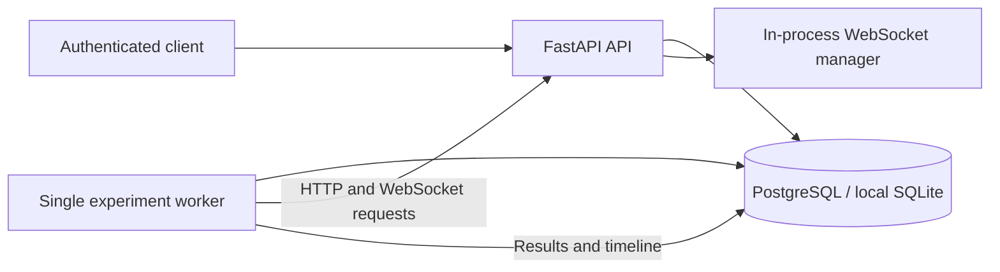
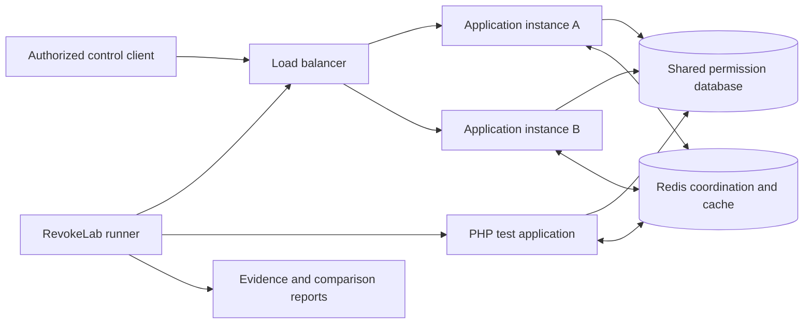

# RevokeLab

**Verify that revoked access actually stops.**

RevokeLab is an automated access-revocation testing project for cloud-hosted applications. It investigates whether removed collaborators or compromised accounts can continue accessing protected information through existing sessions, HTTP endpoints, or realtime connections.

The current prototype demonstrates WebSocket revocation failures and records experiment outcomes with an evidence timeline. The expanded design adds distributed cloud experiments, Redis coordination, authorized control users, and a PHP application target for session and permission-revocation testing.

[Repository](https://github.com/quratulain-nayeem/RevokeLab) · [Hosted API documentation](https://revokelab.onrender.com/docs) · [Health endpoint](https://revokelab.onrender.com/health)

## The problem

Updating a permission record does not automatically invalidate every existing access path. A connection may retain permissions checked at login, an instance may use stale authorization data, or a revocation notification may arrive late.

RevokeLab asks:

> After access is revoked and the allowed enforcement deadline expires, can the revoked user still obtain newly created protected information?

The goal is reproducible verification: demonstrate a failure, change the enforcement strategy, and repeat the experiment to evaluate the fix.

## Implementation status

This table distinguishes the repository's current implementation from the expanded project scope.

| Capability | Status |
|---|---|
| FastAPI application with authenticated HTTP endpoints | Implemented |
| Connection-only versus per-message WebSocket authorization | Implemented |
| Database-backed experiment queue, retries, and event timelines | Implemented |
| Configurable cutoff of 1–60 seconds | Implemented |
| Pass, fail, and inconclusive outcomes | Implemented |
| Render configuration with PostgreSQL and an integrated worker | Included |
| Automated HTTP and WebSocket probes across multiple cloud instances | Planned extension |
| Redis coordination and permission-cache experiments | Planned extension |
| Authorized control receivers and exact test-message matching in the runner | Planned extension |
| Delayed notifications and application-instance restart experiments | Planned extension |
| PHP session and permission-revocation target | Planned extension |
| Compromised-credential containment scenarios | Planned extension |

## How the current experiment works

1. An authenticated client submits an experiment with an `Idempotency-Key`.
2. The API stores the job and returns `202 Accepted`.
3. The worker authenticates the configured test user and opens a WebSocket connection.
4. An administrator revokes that user's project membership.
5. The worker waits for the configured cutoff and creates a new private message.
6. It observes the connection and records the outcome and timeline.
7. Cleanup attempts to restore the test user's membership.

The runner currently uses the configured Alice/admin accounts and project **1**. Use this seeded project for the current demonstration.

### Authorization strategies

| Mode | Behavior | Expected demonstration |
|---|---|---|
| `connection-only` | Checks authorization when the socket connects | Existing connections can receive private messages after membership is revoked |
| `continuous` | Rechecks authorization before each private-message delivery | Sends `access_revoked` and closes the revoked user's connection |

`continuous` checks access at message delivery; it does not immediately disconnect an idle socket when membership changes.

### Reading results

Job execution status and security outcome are separate:

| Field/value | Meaning |
|---|---|
| `status: succeeded` | The experiment completed, regardless of its security outcome |
| `result: fail` | The runner observed a private-message event after the cutoff |
| `result: pass` | The runner observed an explicit `access_revoked` event |
| `result: inconclusive` | The observation timed out or did not establish either outcome |
| `status: failed` | Execution could not complete within the retry policy |

A timeout is not proof of successful revocation. A passing result applies to the tested scenario and observation window, not every possible access path.

## Architecture

### Current prototype



The database persists experiment jobs. The worker can run within the API process or separately. WebSocket connections and broadcasts currently belong to one application process.

### Expanded cloud design — planned



The expanded environment will provide instance identifiers and controlled per-instance probe paths. Redis will support experiments with cache validity, revocation notifications, and cross-instance message delivery. The shared database remains the source of permission state.

Experiments will compare normal operation with delayed notifications and instance restarts. Authorized control clients will confirm that protected information remains available to legitimate users while revoked clients are tested.

## PHP application revocation testing — planned

A small PHP application will serve as another target. RevokeLab remains the test orchestrator; it does not need to be rewritten in PHP.

The target will provide login, protected synthetic records, and administrator-controlled revocation. Paired flawed and corrected implementations will support these experiments:

| Scenario | Failure to reproduce | Enforcement to verify |
|---|---|---|
| Account disabled | Existing sessions retain access | Protected requests reject the disabled account |
| Permission removed | A session uses permissions saved at login | Current permissions or their version are checked |
| All sessions revoked | Only one session loses access | Every session covered by the action is rejected |
| Cache invalidation delayed | One instance accepts stale permissions | Access stops within the configured deadline |

The runner will preserve a test session cookie, trigger revocation, create a fresh record, and probe each instance. Evidence will identify the record, serving instance, observation time, and authorization decision.

This module tests **revocation vulnerabilities in PHP applications**. It is not a general PHP vulnerability scanner and does not claim to reproduce an unidentified PHP CVE.

## Compromised-credential containment — planned

A simulated attacker will use a copy of a test credential. After the credential or its associated access is revoked, RevokeLab will check whether protected HTTP requests and established realtime connections still work.

This evaluates containment after credential exposure. It does not detect malicious packages, establish that a compromised server has been cleaned up, or recover previously disclosed data.

## Evaluation plan

Repeated experiments will compare enforcement strategies under normal operation and controlled cloud failures.

- **Reference time:** record acknowledgement of revocation and the configured deadline.
- **Fresh evidence:** create uniquely identified protected records and match observations to those identifiers.
- **Access window:** measure observed time until enforcement, reporting probe intervals and timing uncertainty.
- **Post-deadline disclosure:** count fresh protected records received beyond the deadline.
- **Instance consistency:** identify instances that enforce revocation late or inconsistently.
- **Control availability:** confirm authorized users can still access the test data.
- **Repeatability:** retain scenario configuration, instance identity, attempt number, timestamps, and outcome.

The current runner uses a cutoff followed by a single observation. Repeated probing, exact identifier matching, and control-client validation are required before claiming precise revocation latency or comprehensive distributed enforcement.

## Run locally

Use Python 3.12. These commands are for PowerShell:

```powershell
git clone https://github.com/quratulain-nayeem/RevokeLab.git
cd RevokeLab
py -3.12 -m venv .venv
.\.venv\Scripts\Activate.ps1
python -m pip install -r requirements.txt
Copy-Item .env.example .env
```

Edit `.env` before starting:

| Setting | Purpose |
|---|---|
| `REVOKELAB_SESSION_SECRET` | Random secret for signing session cookies |
| `DATABASE_URL` | Local SQLite URL or PostgreSQL connection URL |
| `REVOKELAB_BASE_URL` | API origin used by the worker; locally `http://127.0.0.1:8000` |
| `REVOKELAB_ADMIN_USERNAME`, `REVOKELAB_ADMIN_PASSWORD` | Administrator test account |
| `REVOKELAB_ALICE_USERNAME`, `REVOKELAB_ALICE_PASSWORD` | Revoked-user test account |
| `REVOKELAB_BOB_PASSWORD` | Additional seeded account password |
| `REVOKELAB_RUN_WORKER` | Enable the integrated worker when `true` |
| `REVOKELAB_SECURE_COOKIES` | `true` for HTTPS deployments; `false` for local HTTP |

Replace all placeholder secrets and passwords. Keep `.env` out of version control.

Seed the database and start the API:

```powershell
python seed.py
uvicorn app.main:app --reload
```

Open [local API documentation](http://127.0.0.1:8000/docs).

With `REVOKELAB_RUN_WORKER=false`, open another terminal, activate the same environment, and start the worker:

```powershell
python worker.py
```

Use `python worker.py --once` to process at most one available job. Run only one worker; do not enable both the integrated worker and a separate worker.

### Submit an experiment

Authenticate through `POST /auth/login`, then use the same authenticated session to call `POST /experiments`.

Header:

```text
Idempotency-Key: demo-connection-only-001
```

Body:

```json
{
  "project_id": 1,
  "authorization_mode": "connection-only",
  "cutoff_seconds": 5
}
```

Read the returned ID through `GET /experiments/{id}`. Repeat with `authorization_mode: continuous` and a new idempotency key to compare behavior. Wait for the first run and cleanup to finish before starting the comparison.

Reusing a key with the same request returns the existing experiment. Reusing it with a different request returns `409 Conflict`.

## API reference

| Method | Endpoint | Purpose |
|---|---|---|
| `POST` | `/auth/login` | Create an authenticated session |
| `POST` | `/auth/logout` | End the calling session |
| `GET` | `/auth/me` | Read the current account |
| `GET` | `/projects/{id}` | Read an authorized project |
| `POST` | `/projects/{id}/messages` | Create a message with a unique `message_code` |
| `POST` | `/projects/{id}/members/{user_id}/revoke` | Revoke membership as an administrator |
| `POST` | `/projects/{id}/members/{user_id}/grant` | Restore membership as an administrator |
| `POST` | `/experiments` | Queue an experiment |
| `GET` | `/experiments/{id}` | Read its result and timeline |
| WebSocket | `/ws/connection-only/projects/{id}` | Check authorization at connection time |
| WebSocket | `/ws/continuous/projects/{id}` | Recheck authorization at private-message delivery |
| `GET` | `/health` | Basic service health response |

## Cloud deployment

The repository includes `render.yaml` for a FastAPI web service, PostgreSQL database, generated session secret, HTTPS-only cookies, and an integrated worker.

1. Deploy the repository using the Render Blueprint configuration.
2. Supply the administrator, Alice, and Bob test-account passwords.
3. Explicitly set `REVOKELAB_BASE_URL` to the deployed API origin, such as `https://revokelab.onrender.com`.
4. Check `/health`, open `/docs`, and run one experiment in each authorization mode.

The current worker reads `REVOKELAB_BASE_URL` directly, and the Blueprint does not declare it. Set it in the service environment before running experiments.

This configuration is the cloud baseline. Multi-instance coordination, Redis, the PHP target, and fault injection require additional implementation and deployment configuration. Hosting availability and plan requirements depend on the provider.

## Persistence and recovery

The database stores users, projects, memberships, messages, experiment runs, and ordered experiment events. Unique constraints support retry-safe message creation and experiment submission; foreign keys preserve relationships.

The single worker persists attempt counts and job state. It can retry queued or interrupted jobs and records recovery events, with a default maximum of three attempts.

```text
queued -> running -> succeeded
                  -> queued for retry
                  -> failed after maximum attempts
```

Experiment records are restricted to their owner or an administrator. Passwords are hashed with Argon2.

## Tests

```powershell
pytest -v
```

The repository contains tests for authentication, password hashing, project isolation, message idempotency, membership revocation and restoration, both WebSocket authorization modes, and experiment submission/idempotency behavior.

Distributed failure scenarios and PHP-target tests will be added alongside their implementations. Existing tests do not establish end-to-end cloud reliability.

## Current limitations and next steps

- **Single-process messaging:** WebSocket state is in memory; broadcasts do not span replicas.
- **Single experiment worker:** concurrent workers require safe transactional job claiming and coordinated recovery.
- **Fixed target:** the runner targets project 1 and configured accounts, even though experiment submissions accept a project ID.
- **Limited observation:** the runner classifies an event by type; exact message-ID matching and a control receiver remain to be added.
- **Recovery isolation:** interrupted runs may leave membership state changed; restoring a known baseline before each attempt needs strengthening.
- **Target adapters:** PHP and other external applications need explicit login, revocation, and protected-resource integrations.

Priorities are to strengthen experiment isolation and evidence checks, add HTTP probes and control clients, introduce shared cloud coordination, and then integrate the PHP target and fault experiments.

## Intended use

Run experiments against owned or explicitly authorized test environments using synthetic records and dedicated accounts. Keep deliberately flawed targets isolated from production data.

## License

This project is licensed under the [MIT License](LICENSE).
